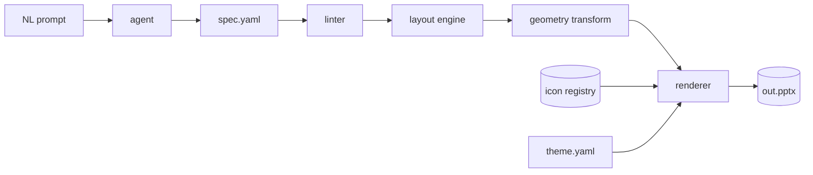

# Architecture — file-by-file reference

Maps every source file to its responsibility, key public surface, and dependencies.
Companion to [../SPEC.md](../SPEC.md). Keep this in sync when adding/renaming modules.

## Pipeline



## Package layout

```
archgen/
  registry/   icon manifest, resolver, SVG→picture converter, fetcher
  spec/       pydantic models, linter, JSON-Schema, YAML I/O
  layout/     Graphviz + pure-Python flow layouts, semantic network layout, geometry
  render/     theme tokens, renderer, legends
  agent/      prompt builder, generate-with-retry loop
  cli.py      command-line entry point
assets/icons/ downloaded/generated icon SVGs (gitignored)
examples/     sample specs
tests/        pytest suite
docs/         this reference + spec format
```

---

## `archgen/registry/` — icons

| File | Responsibility | Key surface |
|---|---|---|
| `manifest.json` | Source of truth: `key → {file, provider, display_name, category, recolorable, brand_hex, source}`. `source` ∈ `official-*`/`flat-color-icons`/`logos`/`devicon`/`simple-icons`/`placeholder`; `brand_hex` tints recolorable monochrome logos. Generated by `fetch.py`. | data |
| `resolver.py` | Resolve a canonical key to an on-disk SVG + metadata (incl. `brand_hex`). Cheap, cached. | `IconResolver.exists/get/keys/suggest`, `IconEntry` |
| `emf.py` | SVG → PPTX-embeddable picture. Engine order: Inkscape→LibreOffice (EMF) → QuickLook→cairosvg (PNG). Content-hash cache. Normalizes fixed px sizes; recolors monochrome CC0 logos only; the QuickLook path flood-fills the white canvas to **transparent**. | `to_picture()`, `available_engine()`, `svg_aspect()`; `_normalize_size`, `_apply_fill`, `_trim_quicklook_canvas` |
| `fetch.py` | Populate the registry: auto-discover official AWS/Azure/GCP packs, preserve aliases, merge cached online additions, fetch curated Simple Icons tech logos, fetch **Flat Color** generic concept icons, upgrade tech logos to **full-color** artwork, and build the manifest. | `main()`, `discover_official_icons()`, `fetch_simple_icons()`, `fetch_flat_color_icons()`, `apply_color_logos()`, `build_manifest()`; seeds `CLOUD_SEED`/`TECH_SEED`/`GENERIC_SEED` |
| `online.py` | Search the published Simple Icons catalog, download a version-pinned SVG (**color-first**: tries Iconify `logos`/`devicon` before the monochrome Simple Icon), reject active/external SVG content, and persist provenance/license/`brand_hex` metadata for offline reuse. | `fetch_catalog()`, `search_catalog()`, `download_simple_icon()`, `fetch_color_logo()`, `color_logo_candidates()`, `record_download()` |

**Depends on:** `requests` (fetch only), `cairosvg` (optional raster). External binaries
`inkscape`/`soffice`/`qlmanage` used opportunistically.

---

## `archgen/spec/` — the declarative spec

| File | Responsibility | Key surface |
|---|---|---|
| `models.py` | Strict pydantic models (`extra="forbid"`) including semantic network roles and connection kinds. | `Diagram`, `Node`, `Group`, `Edge`, `DiagramKind`, `NodeRole`, `GroupKind`, `GroupRole`, `EdgeKind` |
| `lint.py` | Fail-loud validation of all spec invariants; returns human-readable errors. | `lint()`, `MAX_LABEL_LEN`, `_ABBREV_RE` |
| `schema.py` | Export JSON Schema from the models (for the agent prompt). | `json_schema()`, `json_schema_str()` |
| `io.py` | Load a spec from a YAML/JSON file or string. | `load_spec()` |

**Depends on:** `pydantic`, `PyYAML`, `registry.resolver` (icon existence checks).

---

## `archgen/layout/` — positioning

| File | Responsibility | Key surface |
|---|---|---|
| `graphviz_layout.py` | Build DOT (`cluster_*` for groups), run `dot -Tjson`, parse node pos/size, cluster bb, edge splines. Also defines the shared `Layout` dataclasses and node-size constants. | `compute_layout()`, `build_dot()`, `Layout`, `NodeLayout`, `ClusterLayout`, `EdgeLayout`, `NODE_W_IN`, `NODE_H_IN` |
| `simple_layout.py` | Pure-Python **group-aware** layered layout: each group is a self-contained block placed like an item, so **containers never overlap**. Same output convention as Graphviz. | `compute_layout()` |
| `network_layout.py` | Deterministic role-based cloud-network layout on a tall architecture-board canvas. Places external clients, DNS, ingress, compute, management, private-access, and managed services into stable zones without spec coordinates. | `compute_layout()` |
| `engine.py` | Dispatcher: use semantic network layout for `kind: network`; otherwise prefer `dot` if present, then the pure-Python fallback. | `compute_layout(diagram, engine="auto"|"graphviz"|"simple") -> (Layout, str)` |
| `geometry.py` | Transform layout coords (points, y-up, center-origin) → PPTX EMU (top-left, y-down) with uniform scale, centering, Y-flip. | `Transform`, `Rect`, `EMU_PER_POINT` |

**Depends on:** `Graphviz` binary (optional), stdlib only otherwise.

---

## `archgen/render/` — aesthetics

| File | Responsibility | Key surface |
|---|---|---|
| `theme.yaml` | All design tokens: fonts, slide size, grid, node/group/edge/legend styling, per-provider palette (hex/tint/line). Edit → every diagram restyles. | data |
| `theme.py` | Load `theme.yaml`, expose tokens + `RGBColor`/EMU helpers. | `Theme`, `load_theme()` |
| `renderer.py` | The deterministic renderer. Flow diagrams use grouped cards + **native PowerPoint elbow connectors** (right-angle, geometric anchors); network diagrams use flat native boundary panels, role-aware icon treatments, explicit Manhattan polylines, and no inherited theme shadows. Recolorable logos are tinted to `brand_hex`. | `Renderer.render()`, `render_spec()`; `_anchor_sides`, `_side_anchor`, `_recolor_hex` |
| `legend.py` | Build provider, abbreviation, and network connection legends from spec content as native editable shapes. | `add_legends()`, `add_connection_legend()` |

**Depends on:** `python-pptx`, `PyYAML`, `registry.emf`/`resolver`, `layout.*`.

---

## `archgen/agent/` — spec generation

| File | Responsibility | Key surface |
|---|---|---|
| `prompt.py` | Build the system prompt: rules + valid icon-key catalog + JSON Schema; and the user prompt. | `build_system_prompt()`, `build_user_prompt()` |
| `generate.py` | Model-agnostic `complete(system, user)->str` loop: parse (tolerating ```fences), lint, feed errors back, retry. Optional Anthropic backend. | `generate_spec()`, `parse_spec_text()`, `anthropic_complete()`, `GenerationError` |

**Depends on:** `PyYAML`, `spec.*`; `anthropic` (optional, lazy import).

---

## `archgen/cli.py`

Commands: `render`, `lint`, `prompt`, `generate`, `icons`, `schema`, `doctor`.
Thin wrappers over the modules above; lazy imports so `--help` is fast.

---

## `tests/`

| File | Covers |
|---|---|
| `test_lint.py` | Each invariant: unknown icon, dangling/self edge, long label, undeclared abbrev, orphan, bad group nesting; valid passes. |
| `test_geometry.py` | Uniform scale, fit, Y-flip, centering, node/bbox mapping. |
| `test_layout.py` | Non-overlapping containers, all nodes positioned, nested containment, semantic network zones. |
| `test_render.py` | Golden flow render plus validation of the Azure private-AKS network example and its connection semantics. |
| `test_registry.py` | Licensing guardrail (only `tech.*` recolorable), manifest resolves, `svg_aspect`. |

---

## Extension points (where to make common changes)

- **Add an icon:** use `archgen icons search/add` for a brand logo — it is color-first
  (Iconify `logos`/`devicon`, else recolored Simple Icons). For a generic concept, add an
  entry to `GENERIC_SEED` in `fetch.py` (Flat Color Icons name → key). For an official cloud
  SVG, drop it under `assets/icons/<provider>/`; installed packs are auto-discovered. Use
  `OFFICIAL_KEY_ALIAS` only for a stable short compatibility name, then run `make icons`.
- **Add/adjust styling:** edit `render/theme.yaml` only — no code change.
- **New edge style / node shape:** `spec/models.py` (enum) + `render/renderer.py` (drawing).
- **New provider palette:** add under `theme.yaml → providers` and `Provider` enum.
- **Tighten layout:** improvements go in `layout/simple_layout.py`; Graphviz path in
  `layout/graphviz_layout.py`. Keep both emitting the same `Layout` convention.
