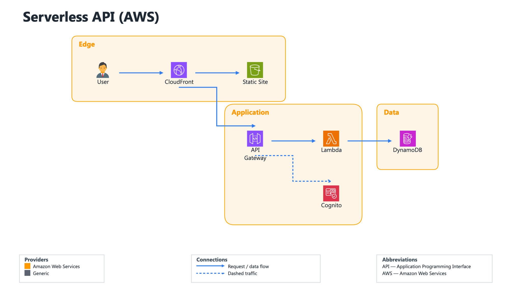
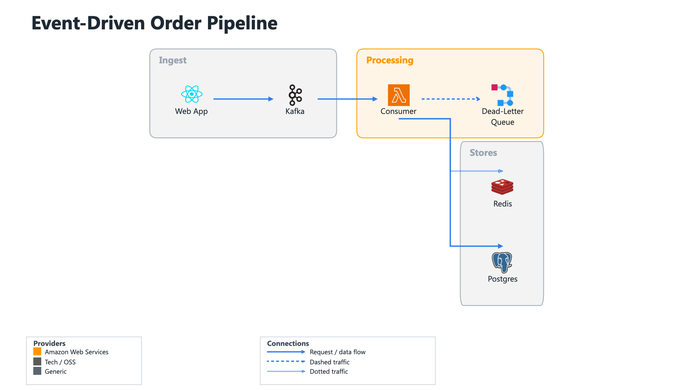
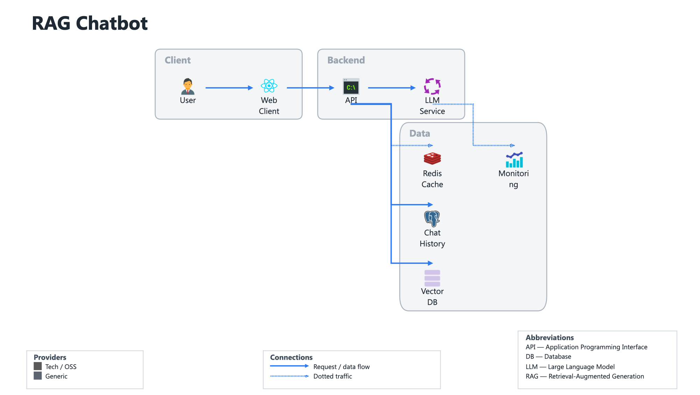
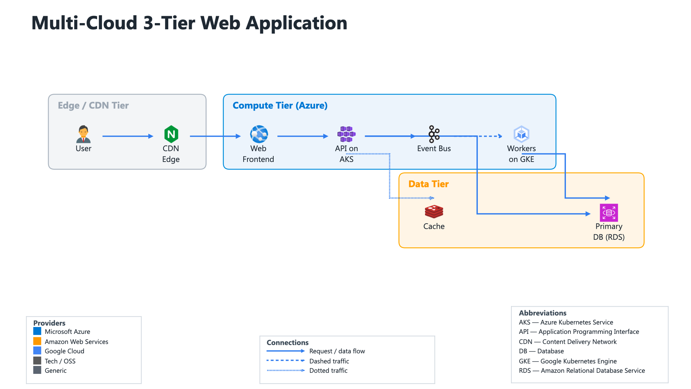
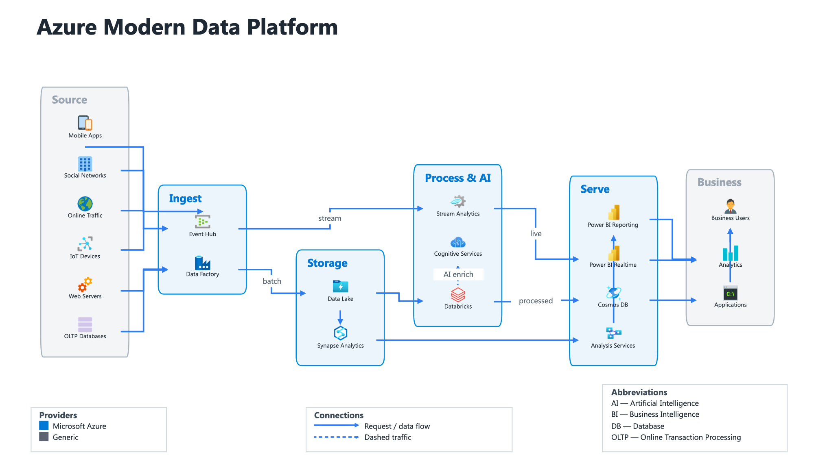
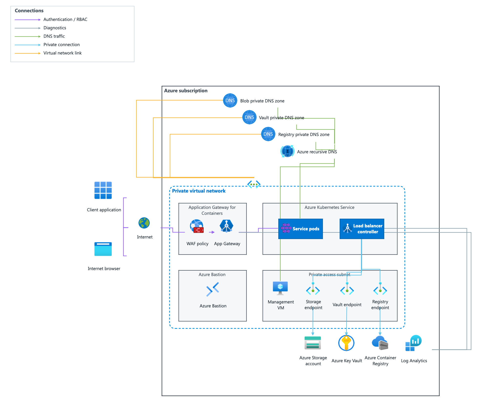
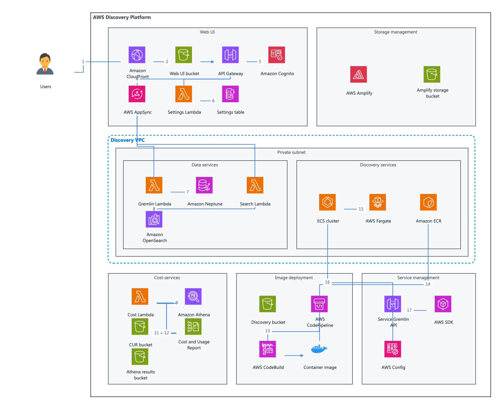
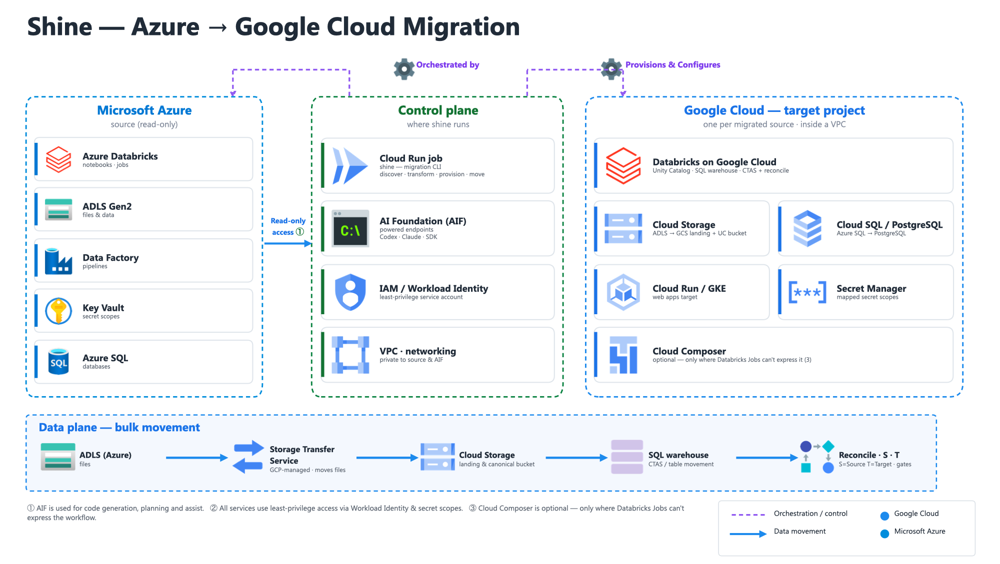
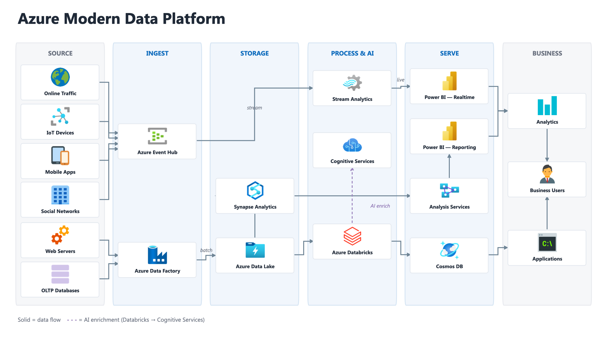

# Gallery — committed reference renders

**Look here first.** These PNGs are the current rendered output of every example
spec (plus the bespoke Shine board). They exist so you don't have to re-render
anything just to see what a spec produces. Open the image; don't run the pipeline
back-to-back to "check."

Regenerate after any change to the renderer, layout, theme, icons, or an example:

```bash
make gallery        # -> ./scripts/build_gallery.sh
```

If a diff changes the renderer/layout/theme, rebuild and eyeball these images —
that is the visual QA (DESIGN_GUIDELINES §"required visual QA"). A single
`make gallery` covers all examples at once.

| Image | Source | Profile |
|---|---|---|
|  | [serverless_api.yaml](../../examples/serverless_api.yaml) | flow (graphviz) |
|  | [event_driven_pipeline.yaml](../../examples/event_driven_pipeline.yaml) | flow (graphviz) |
|  | [rag_chatbot.yaml](../../examples/rag_chatbot.yaml) | flow (graphviz) |
|  | [sample_spec.yaml](../../examples/sample_spec.yaml) | flow (graphviz) |
|  | [layered_data_platform.yaml](../../examples/layered_data_platform.yaml) | flow (graphviz, `layered`) |
|  | [azure_private_aks.yaml](../../examples/azure_private_aks.yaml) | network |
|  | [aws_discovery_platform.yaml](../../examples/aws_discovery_platform.yaml) | network (architecture board) |
|  | [build_shine.py](../../build_shine.py) | **bespoke** python-pptx (image-faithful; not the archgen renderer) |
|  | [build_azure_data_platform.py](../../custom_builds/build_azure_data_platform.py) | **bespoke** python-pptx (6-tier layered board; not the archgen renderer) |
